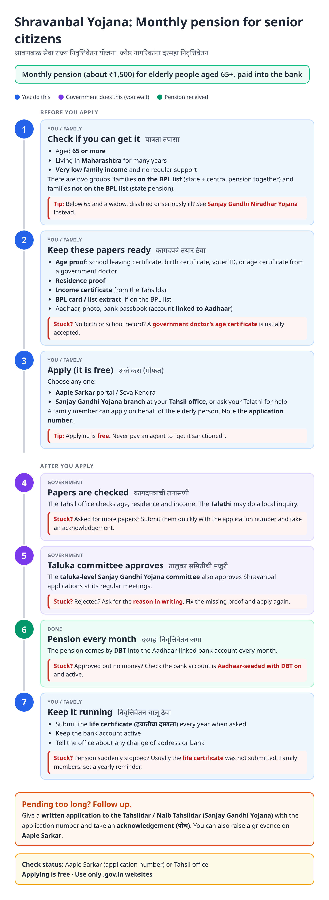
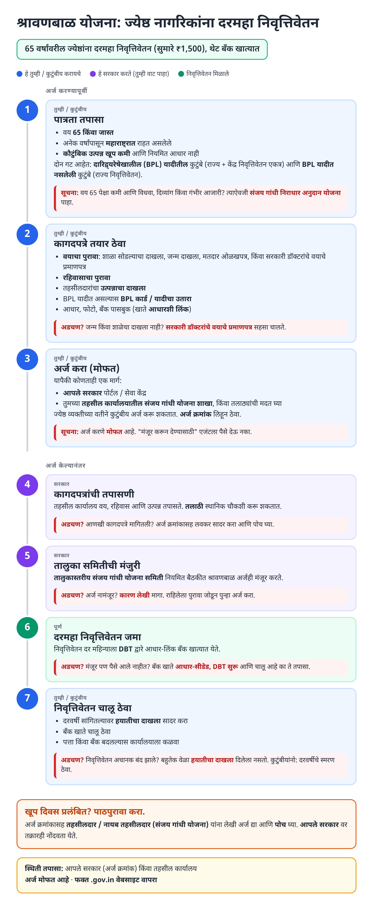
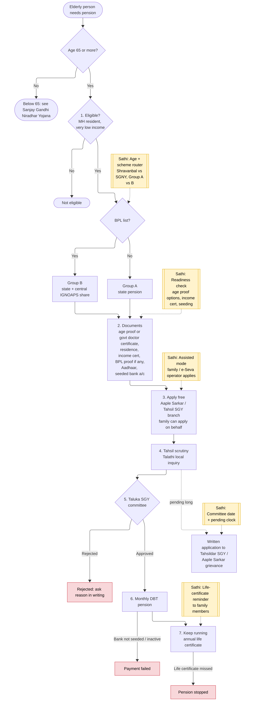
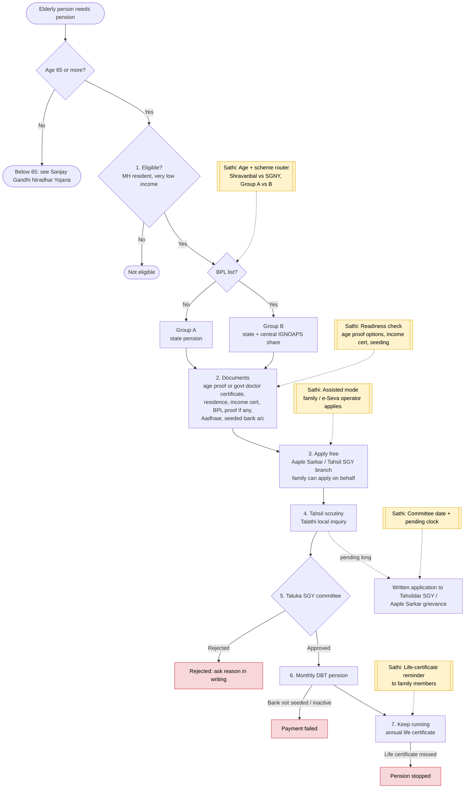

# Shravanbal Seva Rajya Nivruttivetan Yojana - End-to-End Workflow

Maharashtra state pension for destitute senior citizens aged 65+. Two groups: families on the BPL list (state share + central Indira Gandhi National Old Age Pension) and families not on the BPL list (state pension). Applied through Aaple Sarkar or the Sanjay Gandhi Yojana branch at the Tahsil office. Below 65, see [Sanjay Gandhi Niradhar Yojana](sanjay-gandhi.md).

## For citizens: step by step

Blue = you / family do this. Purple = government does this (you wait). Green = pension received. Red = what to do if stuck. Orange = how to follow up.

### English

### मराठी (Marathi)

Sources: [`shravanbal-guide.html`](shravanbal-guide.html), [`shravanbal-guide-mr.html`](shravanbal-guide-mr.html), generated from [`shravanbal_content.py`](shravanbal_content.py) with `python3 gen_guide.py shravanbal_content.py`. Marathi text pending native-speaker review.

## For the Sathi team: system workflow

Yellow boxes = where Sathi plugs in. Red boxes = common blockers.

Mermaid source (editable)

## Stages

| # | Stage | Owner | Common blocker | Sathi action |
|---|---|---|---|---|
| 1 | Eligibility + group | Family | Under 65 applies here; unsure about BPL group | Age + scheme router (Shravanbal vs SGNY, Group A vs B) |
| 2 | Documents | Family | No birth / school record for age | Age-proof options incl. govt doctor certificate; link to [income certificate guide](income-certificate.md) |
| 3 | Apply | Family / e-Seva operator | Elderly person can't travel | Assisted mode: family member applies on behalf |
| 4 | Scrutiny + Talathi inquiry | Tahsil office | Extra papers asked | Explain what is missing |
| 5 | Taluka committee | SGY committee | Pending until next meeting; rejected | Committee-date + pending clock |
| 6 | Monthly DBT | Treasury / bank | Bank inactive / not seeded | Bank check |
| 7 | Keep running | Family | Life certificate missed → pension stopped | Annual life-certificate reminder sent to family members |

**Why this matters for Sathi:** the applicant is elderly but the *user* is usually a son, daughter or e-Seva operator. Sathi's family profile fits naturally: one person manages a parent's pension, a sibling's scholarship and their own certificates. The annual life-certificate reminder alone prevents the most common silent stoppage.

> Note: Working assumptions, not yet verified: benefit amount and Group A / B split, central IGNOAPS share, age and income limits, residence rule, accepted age proofs, committee process, and life-certificate rule. Verify against current Maharashtra Social Justice / Revenue GRs, NSAP guidelines and Aaple Sarkar before building.
