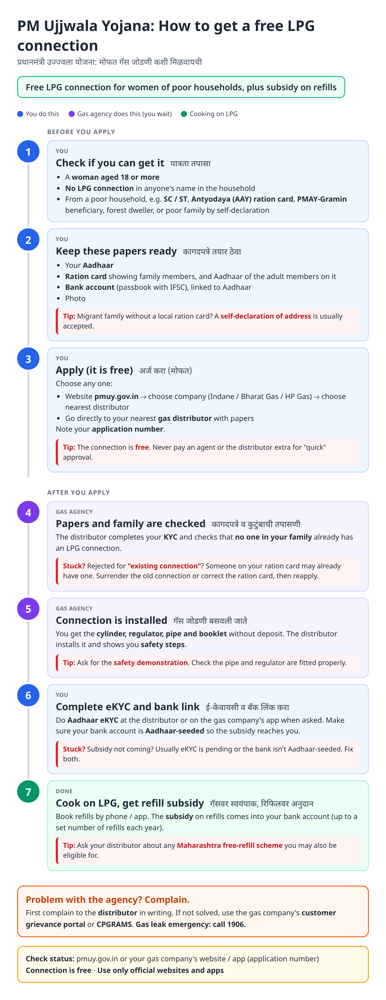
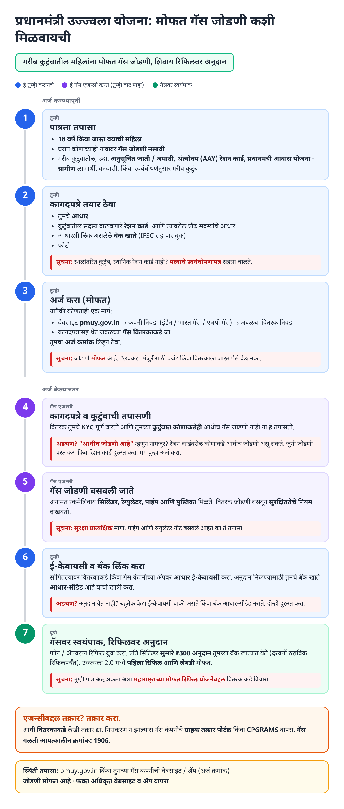
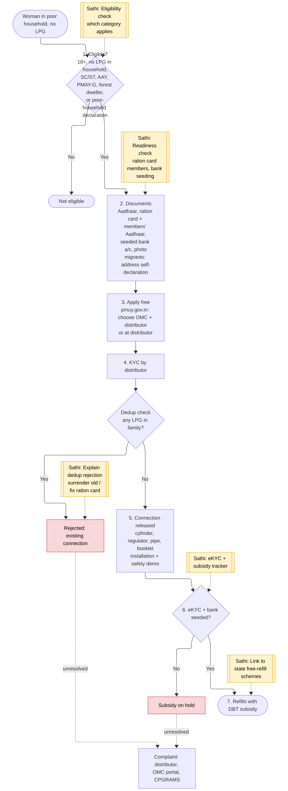

# PM Ujjwala Yojana (PMUY) - End-to-End Workflow

Deposit-free LPG connection for adult women of poor households, plus subsidy on refills. Official site: https://pmuy.gov.in. Delivered through oil marketing companies (Indane, Bharat Gas, HP Gas) and their distributors.

## For citizens: step by step

Blue = you do this. Purple = gas agency does this (you wait). Green = cooking on LPG. Red = what to do if stuck. Orange = how to complain.

### English

### मराठी (Marathi)

Sources: [`ujjwala-guide.html`](ujjwala-guide.html), [`ujjwala-guide-mr.html`](ujjwala-guide-mr.html), generated from [`ujjwala_content.py`](ujjwala_content.py) with `python3 gen_guide.py ujjwala_content.py`. Marathi text pending native-speaker review.

## For the Sathi team: system workflow

Yellow boxes = where Sathi plugs in. Red boxes = common blockers.

Mermaid source (editable)

## Stages

| # | Stage | Owner | Common blocker | Sathi action |
|---|---|---|---|---|
| 1 | Eligibility | Citizen | Unsure which category applies | Category check (SC/ST, AAY, [PMAY-G](pmay-gramin.md), self-declaration) |
| 2 | Documents | Citizen | Ration card members' Aadhaar missing; bank not seeded | Readiness check |
| 3 | Apply | Citizen / distributor | Pays agent for a free connection | "It is free" messaging |
| 4 | KYC + dedup | Distributor / OMC | Rejected: existing connection in family | Explain: surrender old connection or fix ration card |
| 5 | Installation | Distributor | Skipped safety check | Safety checklist; 1906 emergency number |
| 6 | eKYC + bank | Citizen | Subsidy on hold | eKYC + subsidy tracker |
| 7 | Refills | Citizen / OMC | Subsidy not credited; doesn't know state free-refill schemes | Subsidy tracker; link to state schemes (cross-sell with [Ladki Bahin](ladki-bahin.md)) |

**Why this matters for Sathi:** Ujjwala is short and simple, so it is a good "first win" in the family profile. The same woman is often eligible for Ladki Bahin and state free-refill support, and the same Aadhaar-bank seeding fix unblocks all of them.

## Verification (27 Oct 2026, batch 3)

- **Confirmed:** under Ujjwala 2.0 the **first refill and stove (hotplate) are free**; **migrants can give a self-declaration** instead of address proof / ration card; targeted subsidy **₹300 per 14.2 kg cylinder**.
- **Conflicting:** annual refill cap (12 refills to 2024-25 vs 9 refills for 2025-26). Guide says "up to a set number of refills".
- **Changed in guide:** added ₹300 per cylinder and free first refill + stove.
- **Still unverified:** eligibility category list, eKYC rule, Maharashtra free-refill scheme.

Sources: [BankBazaar: PMUY scheme](https://www.bankbazaar.com/gas-connection/pradhan-mantri-ujjwala-yojana-scheme.html) · [Drishti IAS note](https://www.drishtiias.com/pdf/1759320263.pdf) · [Rajya Sabha question, Feb 2025](https://rsdebate.nic.in/bitstream/123456789/758543/1/PQ_267_10022025_U777_p406_p407.pdf) · [Money9: Ujjwala 2.0 free stove and refill](https://www.money9.com/news/economy/prime-minister-narendra-modi-to-unveil-ujjwala-2-0-tomorrow-beneficiaries-will-get-stove-one-refill-free-66576.html)
