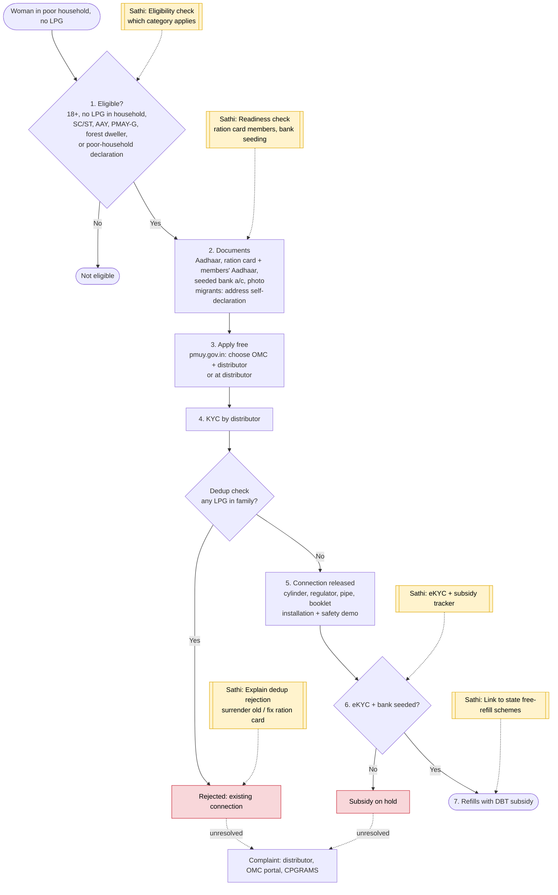

# PM Ujjwala Yojana (PMUY) - End-to-End Workflow

Deposit-free LPG connection for adult women of poor households, plus subsidy on refills. Official site: https://pmuy.gov.in. Delivered through oil marketing companies (Indane, Bharat Gas, HP Gas) and their distributors.

## For citizens: step by step

Blue = you do this. Purple = gas agency does this (you wait). Green = cooking on LPG. Red = what to do if stuck. Orange = how to complain.

### English

### मराठी (Marathi)

Sources: [`ujjwala-guide.html`](ujjwala-guide.html), [`ujjwala-guide-mr.html`](ujjwala-guide-mr.html), generated from [`ujjwala_content.py`](ujjwala_content.py) with `python3 gen_guide.py ujjwala_content.py`. Marathi text pending native-speaker review.

## For the Sathi team: system workflow

Yellow boxes = where Sathi plugs in. Red boxes = common blockers.

Mermaid source (editable)

## Stages

| # | Stage | Owner | Common blocker | Sathi action |
|---|---|---|---|---|
| 1 | Eligibility | Citizen | Unsure which category applies | Category check (SC/ST, AAY, [PMAY-G](pmay-gramin.md), self-declaration) |
| 2 | Documents | Citizen | Ration card members' Aadhaar missing; bank not seeded | Readiness check |
| 3 | Apply | Citizen / distributor | Pays agent for a free connection | "It is free" messaging |
| 4 | KYC + dedup | Distributor / OMC | Rejected: existing connection in family | Explain: surrender old connection or fix ration card |
| 5 | Installation | Distributor | Skipped safety check | Safety checklist; 1906 emergency number |
| 6 | eKYC + bank | Citizen | Subsidy on hold | eKYC + subsidy tracker |
| 7 | Refills | Citizen / OMC | Subsidy not credited; doesn't know state free-refill schemes | Subsidy tracker; link to state schemes (cross-sell with [Ladki Bahin](ladki-bahin.md)) |

**Why this matters for Sathi:** Ujjwala is short and simple, so it is a good "first win" in the family profile. The same woman is often eligible for Ladki Bahin and state free-refill support, and the same Aadhaar-bank seeding fix unblocks all of them.

> Note: Working assumptions, not yet verified: eligibility categories, document list, migrant self-declaration rule, free first refill / stove under PMUY 2.0, refill subsidy amount and annual cap, eKYC requirement, Maharashtra free-refill scheme details, and grievance channels. Verify against current PMUY guidelines, MoPNG notifications, and pmuy.gov.in before building.
