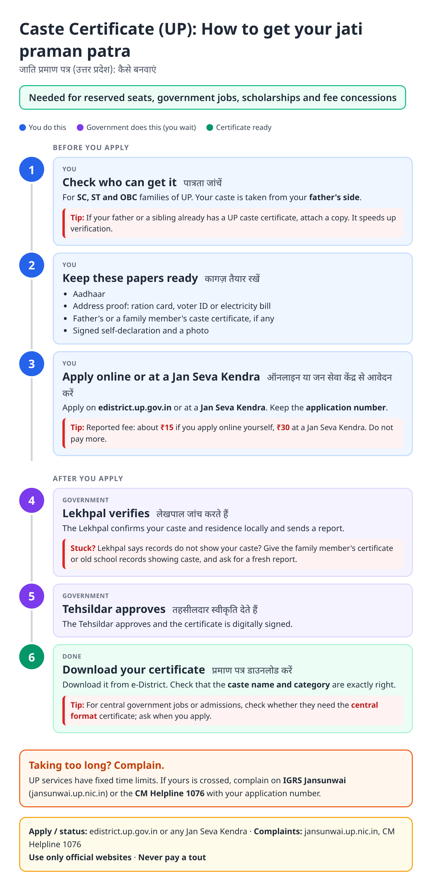
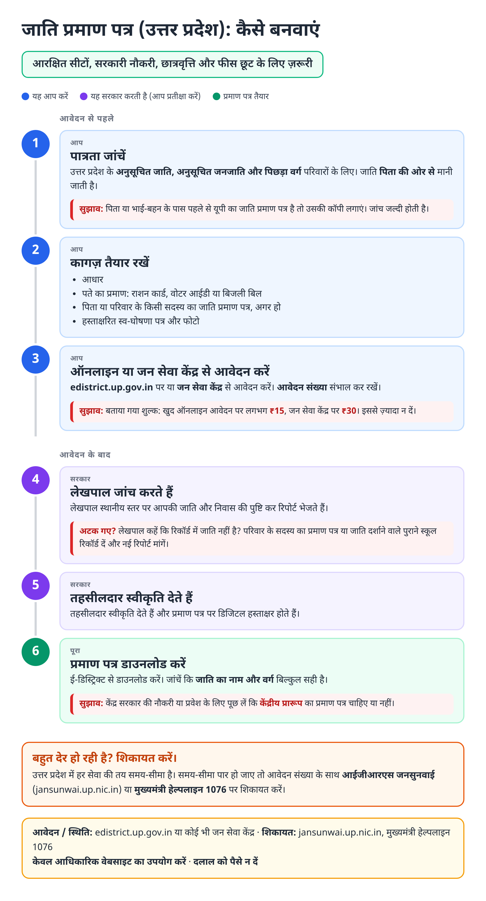
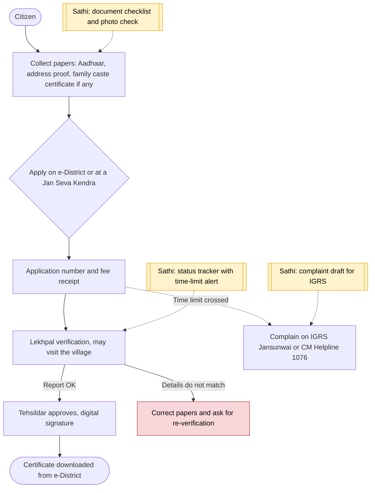

# Caste certificate (UP) - End-to-End Workflow

जाति प्रमाण पत्र · For: SC / ST / OBC families

## For citizens: step by step

Blue = you do this. Purple = government does this (you wait). Green = done. Red = what to do if stuck. Orange = your rights if it is late.

### English

### हिंदी (Hindi)

Sources: [`up-caste-certificate-guide.html`](up-caste-certificate-guide.html), [`up-caste-certificate-guide-hi.html`](up-caste-certificate-guide-hi.html), generated from [`up_caste_certificate_content.py`](up_caste_certificate_content.py) with `python3 ../gen_guide.py up_caste_certificate_content.py`. Hindi text pending native-speaker review.

## Official links

Use only these addresses. Checked on 27 Oct 2026 through search results; the government sites could not be opened directly from our build environment. "Third-party sites only" means several non-government sites agree on the address but no government page confirmed it yet, so open it and check before you share it.

| What | Link | Checked via |
| :--- | :--- | :--- |
| e-District UP: apply, status, download | <https://edistrict.up.gov.in> | Third-party sites only |
| IGRS Jansunwai: complaints | <https://jansunwai.up.nic.in> | Third-party sites only |
| CM Helpline: 1076 | - | Third-party sites only |

## For the Sathi team: system workflow

## Verification (27 Oct 2026)

- **Reported:** applications through e-District or Jan Seva Kendra; caste follows the father's side; Tehsildar issues after Lekhpal report.
- **Left out:** validity period and OBC creamy-layer wording, which sources did not state clearly.
- **Still unverified:** current fee and time limit on the official portal.

Sources: [Housing.com: income, caste or residence certificate on e-District UP](https://housing.com/news/how-to-get-income-caste-or-residence-certificate-on-edistrict-up/) · [LegalRaasta: UP caste certificate](https://www.legalraasta.com/blog/up-caste-certificate-online-apply/) · [BankBazaar: UP caste certificate](https://www.bankbazaar.com/govt-utility/up-caste-certificate.html) · [Anantam IAS: e-District UP](https://anantamias.com/edistrict-up/)
