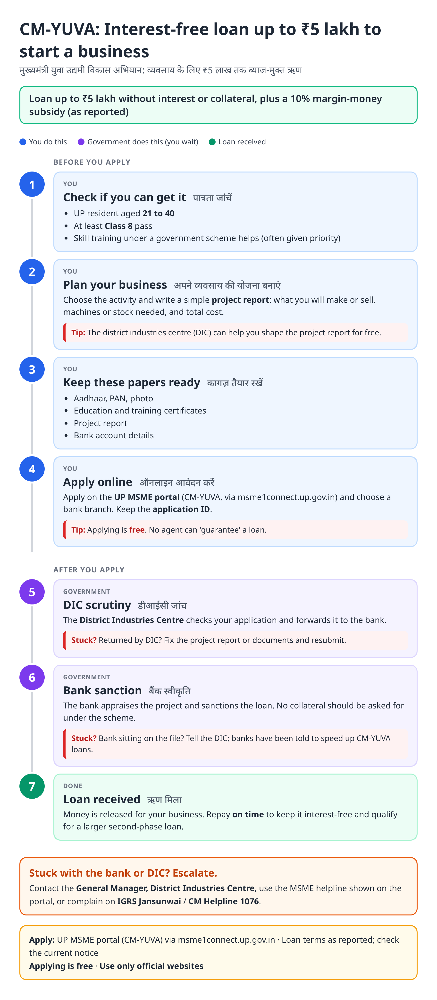
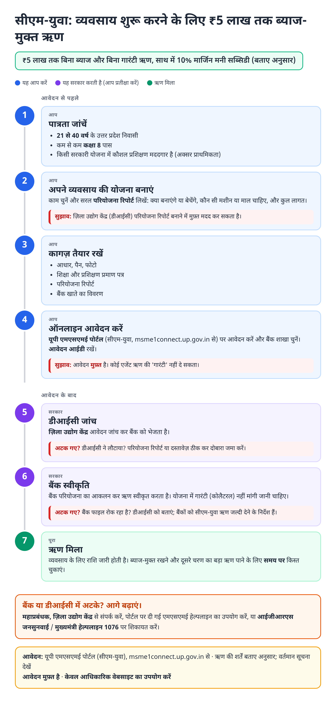
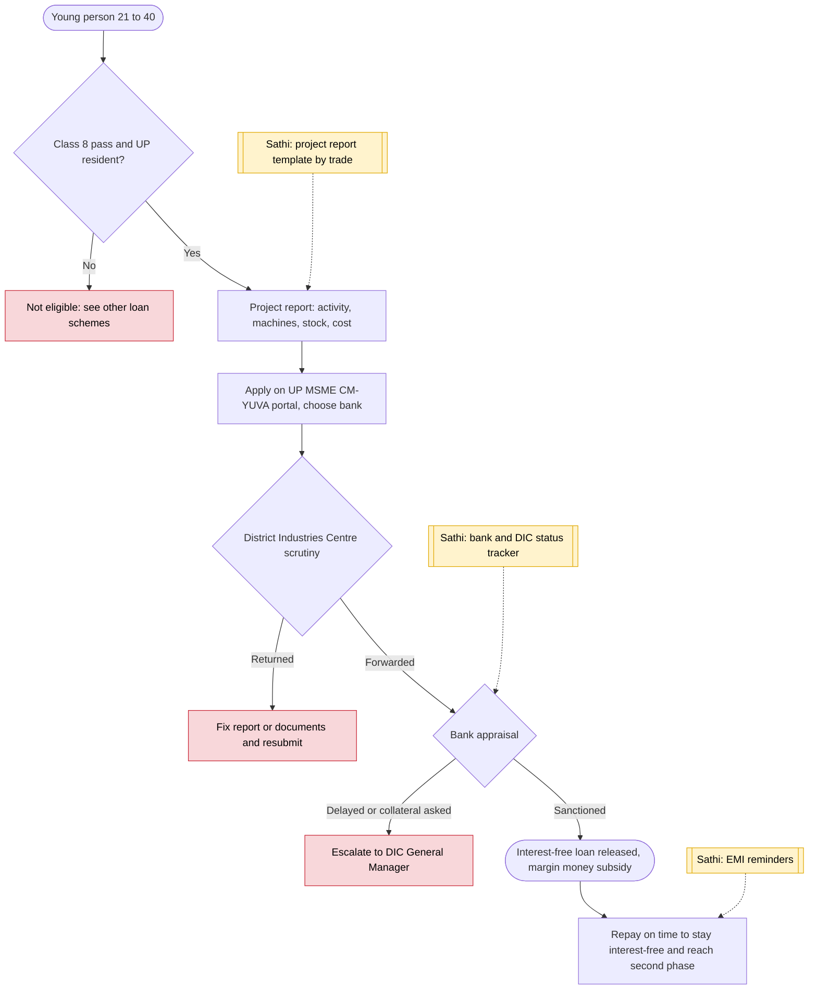

# CM-YUVA (Yuva Udyami loan) - End-to-End Workflow

मुख्यमंत्री युवा उद्यमी विकास अभियान · For: Young people 21–40 starting a small business

## For citizens: step by step

Blue = you do this. Purple = government does this (you wait). Green = done. Red = what to do if stuck. Orange = your rights if it is late.

### English

### हिंदी (Hindi)

Sources: [`up-cm-yuva-guide.html`](up-cm-yuva-guide.html), [`up-cm-yuva-guide-hi.html`](up-cm-yuva-guide-hi.html), generated from [`up_cm_yuva_content.py`](up_cm_yuva_content.py) with `python3 ../gen_guide.py up_cm_yuva_content.py`. Hindi text pending native-speaker review.

## Official links

Use only these addresses. Checked on 27 Oct 2026 through search results; the government sites could not be opened directly from our build environment. "Third-party sites only" means several non-government sites agree on the address but no government page confirmed it yet, so open it and check before you share it.

| What | Link | Checked via |
| :--- | :--- | :--- |
| UP MSME One Connect: CM-YUVA scheme page | <https://msme1connect.up.gov.in/Home/SchemesList/18> | Government page |
| ODOP UP: Mukhyamantri Yuva Udyami page | <https://odopup.in/en/page/myuva> | Third-party sites only |
| IGRS Jansunwai: complaints | <https://jansunwai.up.nic.in> | Third-party sites only |
| CM Helpline: 1076 | - | Third-party sites only |

## For the Sathi team: system workflow

## Verification (27 Oct 2026)

- **Reported:** interest-free, collateral-free loans up to ₹5 lakh; 10 percent margin-money subsidy; age 21 to 40; Class 8 pass; 2026 instruction to banks to speed up disbursal.
- **Conflicting, left out:** second-phase loan size and subsidy (sources differ), and the exact application portal address (msme1connect vs diupmsme.upsdc.gov.in).
- **Still unverified:** helpline numbers.

Sources: [UP MSME One Connect: scheme list](https://msme1connect.up.gov.in/Home/SchemesList/18) · [Moneylife: collateral-free interest-free loans up to ₹5 lakh](https://mas360.moneylife.in/article/uttar-pradesh-government-launches-collateral-free-interest-free-loans-up-to-rs5-lakh-under-mukhyamantri-yuva-udyami-abhiyan-yojana/4773.html) · [KNN India: CM-YUVA eligibility](https://knnindia.co.in/news/newsdetails/sectors/start-up/eligibility-criteria-set-for-ups-mukhyamantri-yuva-udyami-vikas-abhiyan) · [govtschemes.in: CM-YUVA](https://www.govtschemes.in/uttar-pradesh-chief-minister-yuva-udhyami-vikas-abhiyan)
