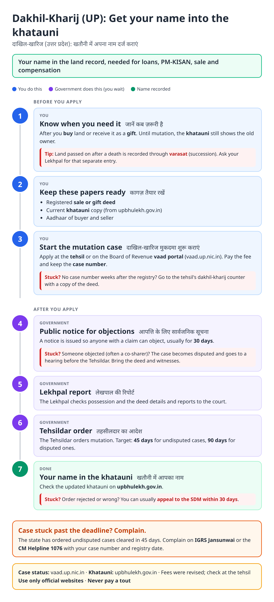
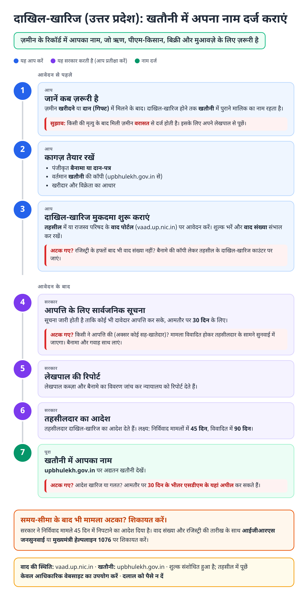
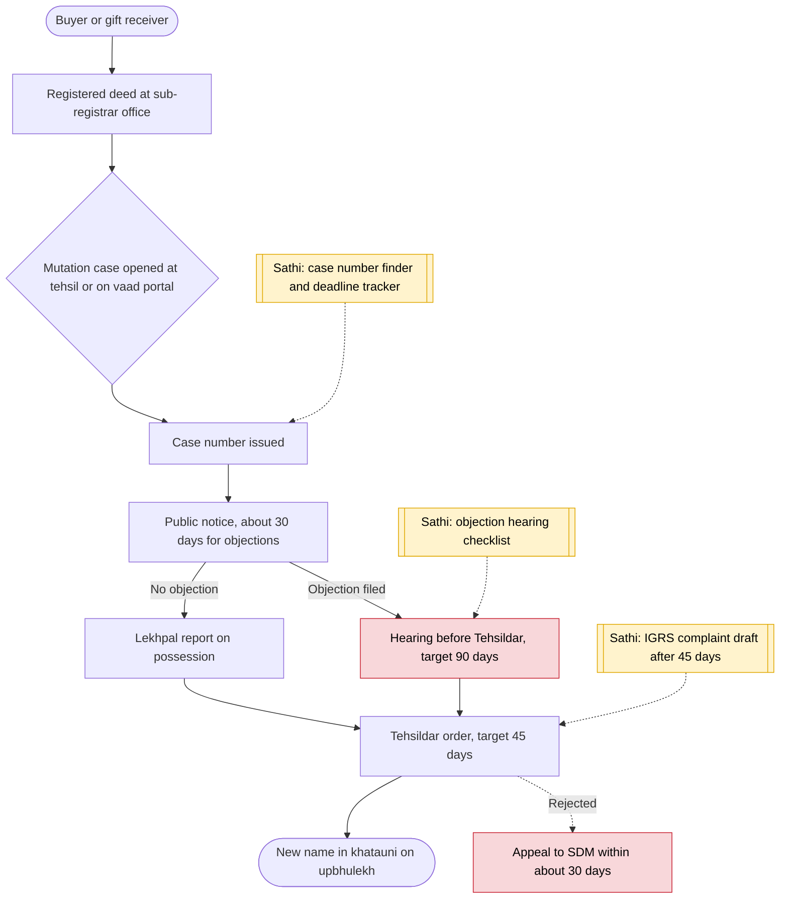

# Dakhil-kharij (UP land mutation) - End-to-End Workflow

दाखिल-खारिज · For: Land buyers, gift receivers (heirs: varasat)

## For citizens: step by step

Blue = you do this. Purple = government does this (you wait). Green = done. Red = what to do if stuck. Orange = your rights if it is late.

### English

### हिंदी (Hindi)

Sources: [`up-dakhil-kharij-guide.html`](up-dakhil-kharij-guide.html), [`up-dakhil-kharij-guide-hi.html`](up-dakhil-kharij-guide-hi.html), generated from [`up_dakhil_kharij_content.py`](up_dakhil_kharij_content.py) with `python3 ../gen_guide.py up_dakhil_kharij_content.py`. Hindi text pending native-speaker review.

## Official links

Use only these addresses. Checked on 27 Oct 2026 through search results; the government sites could not be opened directly from our build environment. "Third-party sites only" means several non-government sites agree on the address but no government page confirmed it yet, so open it and check before you share it.

| What | Link | Checked via |
| :--- | :--- | :--- |
| Board of Revenue vaad portal: case status | <https://vaad.up.nic.in> | Third-party sites only |
| UP Bhulekh: view khatauni | <https://upbhulekh.gov.in> | Third-party sites only |
| IGRS Jansunwai: complaints | <https://jansunwai.up.nic.in> | Third-party sites only |
| CM Helpline: 1076 | - | Third-party sites only |

## For the Sathi team: system workflow

## Verification (27 Oct 2026)

- **Reported:** undisputed cases within 45 days, disputed within 90 days, with DM and Commissioner accountability (2026 news); about 30-day objection notice; appeal to SDM in about 30 days.
- **Conflicting:** whether the case can be started online (vaad portal, e-District) or only at the tehsil. The guide gives both and says to ask at the tehsil.
- **Left out:** exact fee (reported ₹200 to ₹2,500 after revision).

Sources: [The420: UP enforces 45-day mutation deadline](https://the420.in/up-land-mutation-45-day-deadline-dakhil-kharij-disposal-dm-accountability/) · [Realty Hunting: property mutation after purchase](https://realtyhunting.com/property-mutation-after-purchase/) · [1acre: dakhil kharij Uttar Pradesh](https://1acre.in/guides/uttar-pradesh/dakhil-kharij-mutation-uttar-pradesh) · [Landeed: UP property mutation](https://web.landeed.com/products/uttar-pradesh/mutation) · [RTI wiki: mutation status](https://righttoinformation.wiki/check-status/property-mutation-status)
