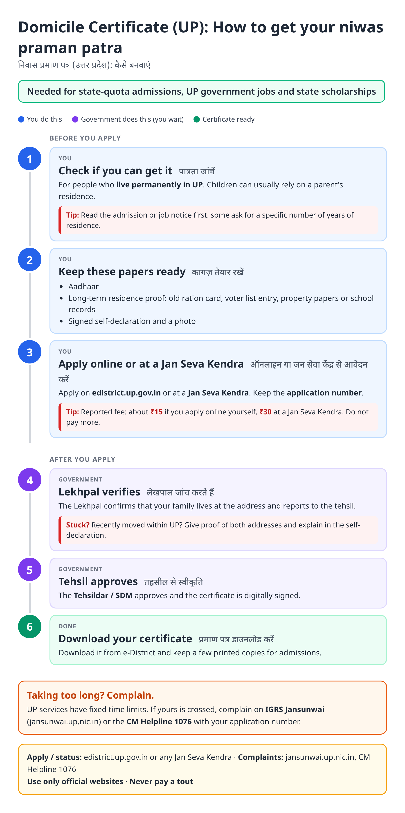
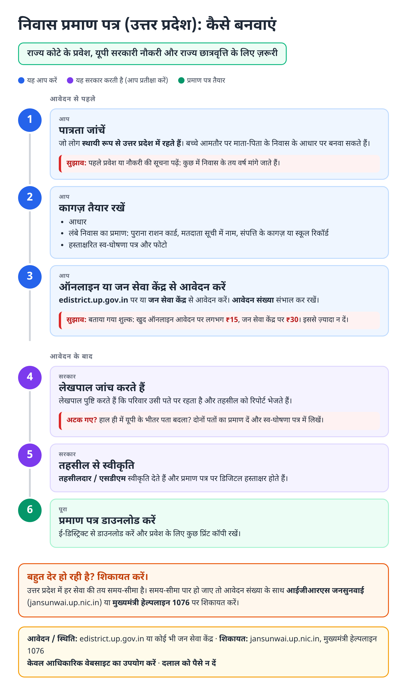
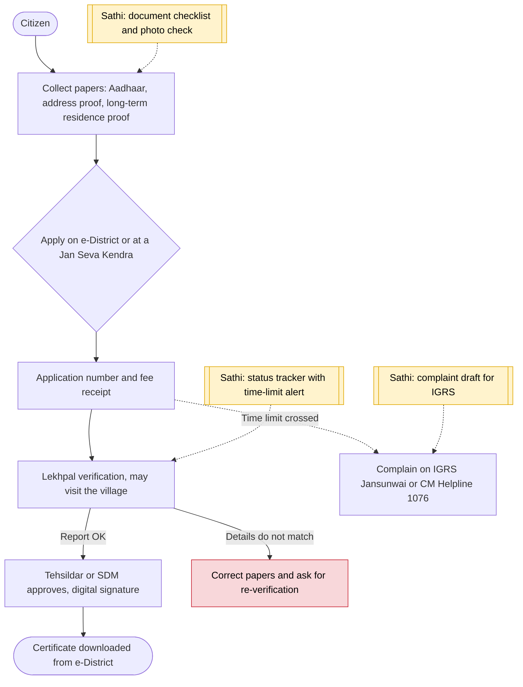

# Domicile certificate (UP) - End-to-End Workflow

निवास प्रमाण पत्र · For: Students and job seekers needing UP residence proof

## For citizens: step by step

Blue = you do this. Purple = government does this (you wait). Green = done. Red = what to do if stuck. Orange = your rights if it is late.

### English

### हिंदी (Hindi)

Sources: [`up-domicile-certificate-guide.html`](up-domicile-certificate-guide.html), [`up-domicile-certificate-guide-hi.html`](up-domicile-certificate-guide-hi.html), generated from [`up_domicile_certificate_content.py`](up_domicile_certificate_content.py) with `python3 ../gen_guide.py up_domicile_certificate_content.py`. Hindi text pending native-speaker review.

## Official links

Use only these addresses. Checked on 27 Oct 2026 through search results; the government sites could not be opened directly from our build environment. "Third-party sites only" means several non-government sites agree on the address but no government page confirmed it yet, so open it and check before you share it.

| What | Link | Checked via |
| :--- | :--- | :--- |
| e-District UP: apply, status, download | <https://edistrict.up.gov.in> | Third-party sites only |
| IGRS Jansunwai: complaints | <https://jansunwai.up.nic.in> | Third-party sites only |
| CM Helpline: 1076 | - | Third-party sites only |

## For the Sathi team: system workflow

## Verification (27 Oct 2026)

- **Reported:** applied through e-District; issued at tehsil level after Lekhpal report; about 15 to 20 days.
- **Conflicting, left out:** required years of residence (10 to 20+ by source) and validity (lifetime vs three years). The guide says to read the admission or job notice.
- **Still unverified:** current fee and time limit.

Sources: [LegalRaasta: UP domicile certificate 2026](https://www.legalraasta.com/blog/uttar-pradesh-domicile-certificate-guide/) · [ClearTax: domicile certificate UP](https://cleartax.in/s/domicile-certificate-uttar-pradesh) · [Bajaj Finserv: domicile certificate UP](https://www.bajajfinserv.in/domicile-certificate-uttar-pradesh) · [RTI wiki: domicile certificate state-wise](https://righttoinformation.wiki/how-to-apply/domicile-certificate)
