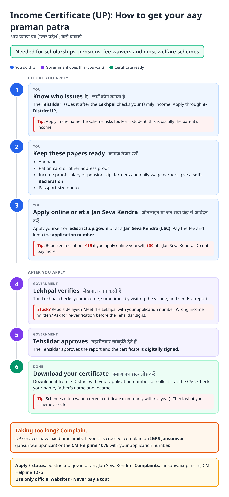
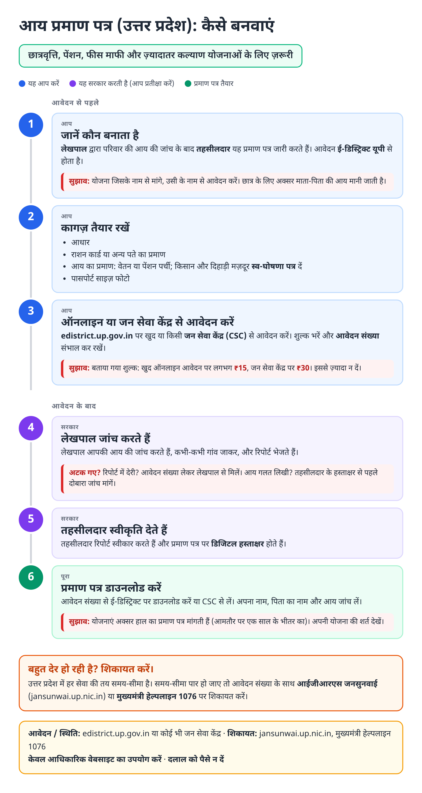
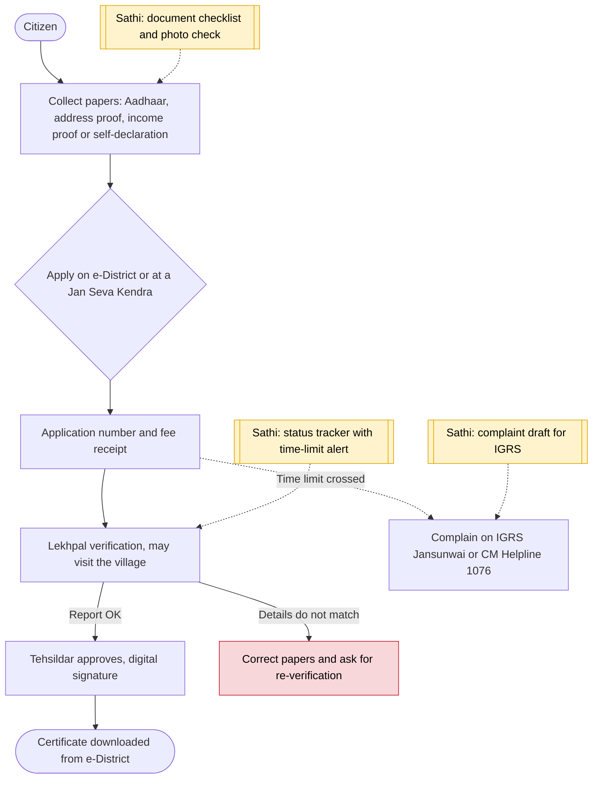

# Income certificate (UP) - End-to-End Workflow

आय प्रमाण पत्र · For: Anyone applying to income-based schemes, scholarships, pensions

## For citizens: step by step

Blue = you do this. Purple = government does this (you wait). Green = done. Red = what to do if stuck. Orange = your rights if it is late.

### English

### हिंदी (Hindi)

Sources: [`up-income-certificate-guide.html`](up-income-certificate-guide.html), [`up-income-certificate-guide-hi.html`](up-income-certificate-guide-hi.html), generated from [`up_income_certificate_content.py`](up_income_certificate_content.py) with `python3 ../gen_guide.py up_income_certificate_content.py`. Hindi text pending native-speaker review.

## Official links

Use only these addresses. Checked on 27 Oct 2026 through search results; the government sites could not be opened directly from our build environment. "Third-party sites only" means several non-government sites agree on the address but no government page confirmed it yet, so open it and check before you share it.

| What | Link | Checked via |
| :--- | :--- | :--- |
| e-District UP: apply, status, download | <https://edistrict.up.gov.in> | Third-party sites only |
| IGRS Jansunwai: complaints | <https://jansunwai.up.nic.in> | Third-party sites only |
| CM Helpline: 1076 | - | Third-party sites only |

## For the Sathi team: system workflow

## Verification (27 Oct 2026)

- **Reported:** Tehsildar issues after Lekhpal field report; fee ₹15 online by self, ₹30 at Jan Seva Kendra (Government Order of 3 Dec 2020, as quoted by secondary guides).
- **Conflicting, left out:** time limit (sources give 7 to 20 days) and validity (six months vs one year). The guide says to check what each scheme asks for.
- **Still unverified:** current e-District fee and service time limit on the official portal.

Sources: [Anantam IAS: e-District UP](https://anantamias.com/edistrict-up/) · [RTI wiki: income certificate state-wise](https://righttoinformation.wiki/how-to-apply/income-certificate) · [RTI wiki: income certificate delays](https://righttoinformation.wiki/rti-for-income-certificate-delay)
