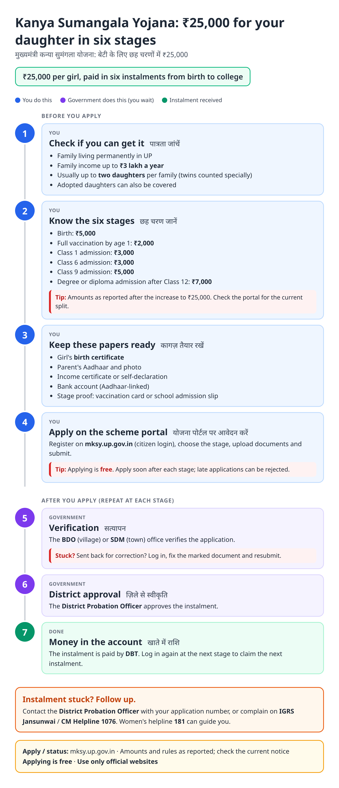
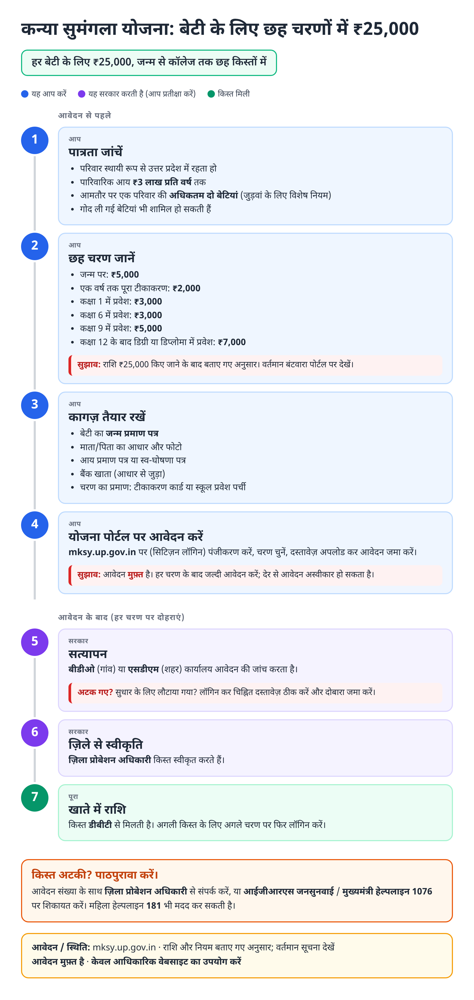
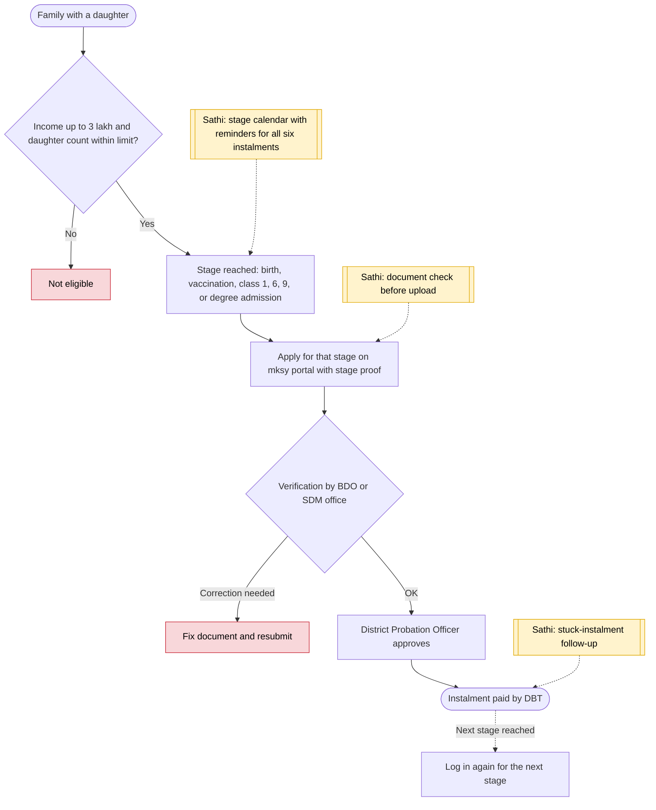

# Kanya Sumangala Yojana - End-to-End Workflow

मुख्यमंत्री कन्या सुमंगला योजना · For: Families with daughters, income up to ₹3 lakh

## For citizens: step by step

Blue = you do this. Purple = government does this (you wait). Green = done. Red = what to do if stuck. Orange = your rights if it is late.

### English

### हिंदी (Hindi)

Sources: [`up-kanya-sumangala-guide.html`](up-kanya-sumangala-guide.html), [`up-kanya-sumangala-guide-hi.html`](up-kanya-sumangala-guide-hi.html), generated from [`up_kanya_sumangala_content.py`](up_kanya_sumangala_content.py) with `python3 ../gen_guide.py up_kanya_sumangala_content.py`. Hindi text pending native-speaker review.

## Official links

Use only these addresses. Checked on 27 Oct 2026 through search results; the government sites could not be opened directly from our build environment. "Third-party sites only" means several non-government sites agree on the address but no government page confirmed it yet, so open it and check before you share it.

| What | Link | Checked via |
| :--- | :--- | :--- |
| Kanya Sumangala portal: apply and status | <https://mksy.up.gov.in> | Third-party sites only |
| IGRS Jansunwai: complaints | <https://jansunwai.up.nic.in> | Third-party sites only |
| CM Helpline: 1076 | - | Third-party sites only |
| Women helpline: 181 | - | Third-party sites only |

## For the Sathi team: system workflow

## Verification (27 Oct 2026)

- **Reported (2026 sources):** ₹25,000 in six instalments (5,000 / 2,000 / 3,000 / 3,000 / 5,000 / 7,000); income up to ₹3 lakh; raised from ₹15,000 in 2024.
- **Conflicting:** family limit described as 'two children' by one source and 'two daughters, three with twins' by another. The guide says 'usually up to two daughters'.
- **Still unverified:** sanctioning officer and stage deadlines on the official portal.

Sources: [Adda247: Kanya Sumangala Yojana 2026](https://currentaffairs.adda247.com/up-mukhyamantri-kanya-sumangala-yojana-2026-benefits-eligibility-documents-required-and-how-to-apply/) · [Utkarsh: Kanya Sumangala 2026](https://utkarsh.com/current-affairs/state/uttar-pradesh/up-mukhyamantri-kanya-sumangala-yojana-2026-benefits-about-eligibility-criteria) · [IndiaScholarships: Kanya Sumangala eligibility](https://www.indiascholarships.in/scholarships/mukhyamantri-kanya-sumangala-yojana/eligibility)
