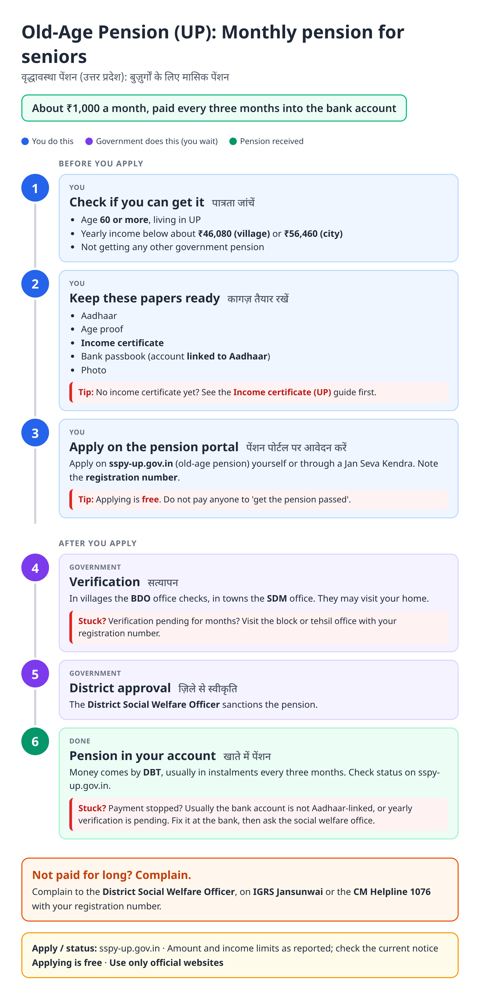
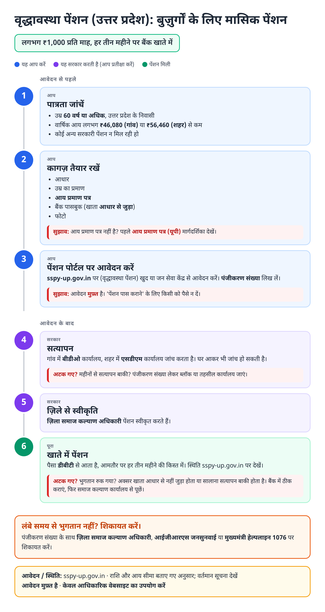
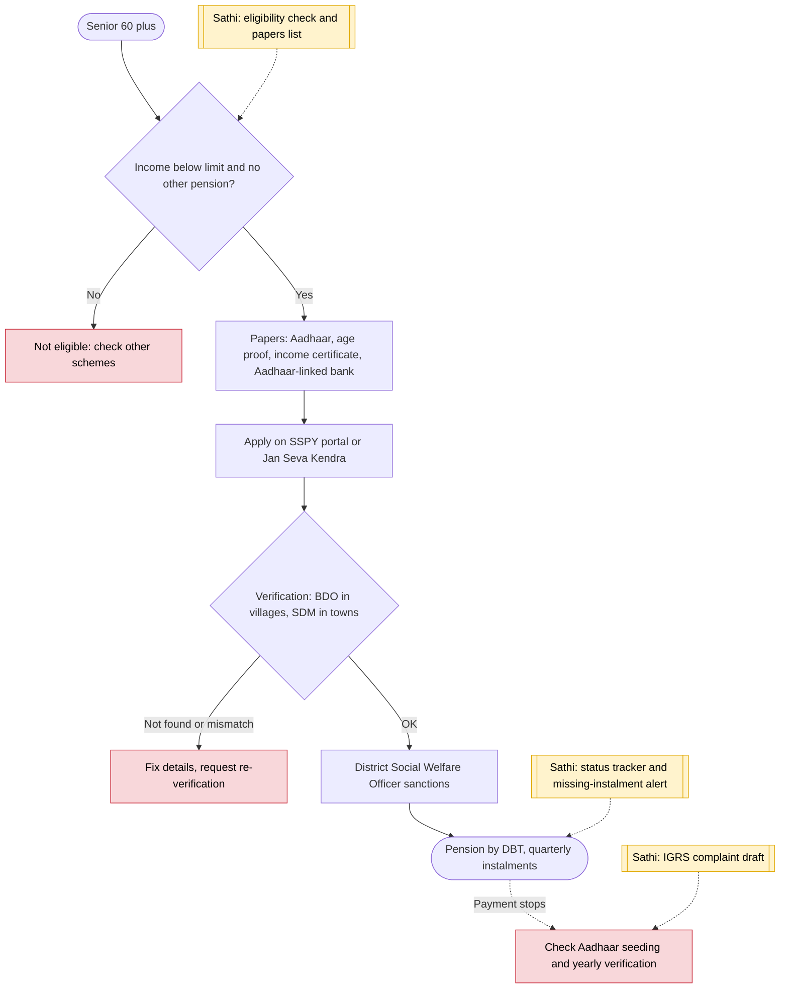

# Vridhavastha Pension (UP old-age pension) - End-to-End Workflow

वृद्धावस्था पेंशन · For: Seniors 60+ with low income

## For citizens: step by step

Blue = you do this. Purple = government does this (you wait). Green = done. Red = what to do if stuck. Orange = your rights if it is late.

### English

### हिंदी (Hindi)

Sources: [`up-old-age-pension-guide.html`](up-old-age-pension-guide.html), [`up-old-age-pension-guide-hi.html`](up-old-age-pension-guide-hi.html), generated from [`up_old_age_pension_content.py`](up_old_age_pension_content.py) with `python3 ../gen_guide.py up_old_age_pension_content.py`. Hindi text pending native-speaker review.

## Official links

Use only these addresses. Checked on 27 Oct 2026 through search results; the government sites could not be opened directly from our build environment. "Third-party sites only" means several non-government sites agree on the address but no government page confirmed it yet, so open it and check before you share it.

| What | Link | Checked via |
| :--- | :--- | :--- |
| SSPY UP: social pension portal | <https://sspy-up.gov.in> | Third-party sites only |
| IGRS Jansunwai: complaints | <https://jansunwai.up.nic.in> | Third-party sites only |
| CM Helpline: 1076 | - | Third-party sites only |

## For the Sathi team: system workflow

## Verification (27 Oct 2026)

- **Reported by most sources:** ₹1,000 a month paid as ₹3,000 a quarter; income limits ₹46,080 (rural) and ₹56,460 (urban) a year; BDO verifies in rural areas, SDM in urban.
- **Conflicting:** one 2026 job-portal page says ₹1,200 a month; not used.
- **Still unverified:** current amount on the official portal.

Sources: [ClearTax: SSPY UP pension scheme](https://cleartax.in/s/sspy-up-pension-scheme) · [PensionBazaar: UP pension schemes](https://www.pensionbazaar.com/pension-and-savings-schemes/government-schemes/uttar-pradesh-pension-scheme/) · [GlobalDrishti: UP Vridha Pension 2026](https://globaldrishti.in/up-vridha-pension-yojana-2026-%e2%82%b91200-monthly-apply/)
