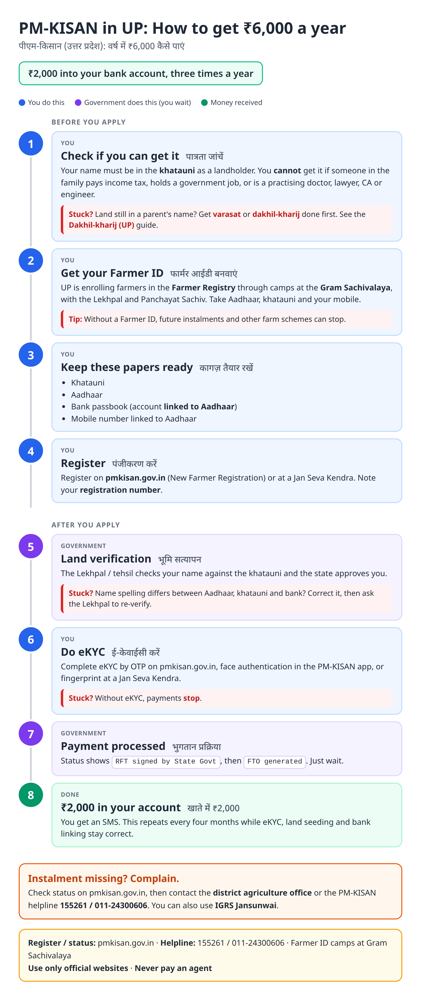
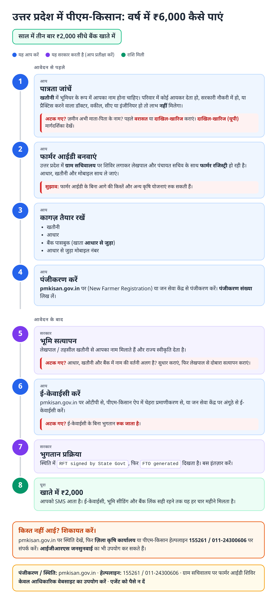
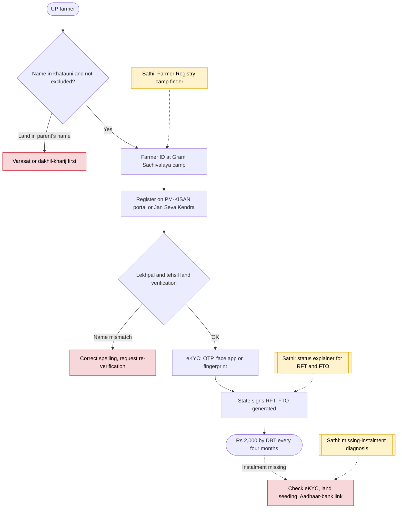

# PM-KISAN (Uttar Pradesh) - End-to-End Workflow

पीएम-किसान (उत्तर प्रदेश) · For: Landholding farmers in UP

## For citizens: step by step

Blue = you do this. Purple = government does this (you wait). Green = done. Red = what to do if stuck. Orange = your rights if it is late.

### English

### हिंदी (Hindi)

Sources: [`up-pm-kisan-guide.html`](up-pm-kisan-guide.html), [`up-pm-kisan-guide-hi.html`](up-pm-kisan-guide-hi.html), generated from [`up_pm_kisan_content.py`](up_pm_kisan_content.py) with `python3 ../gen_guide.py up_pm_kisan_content.py`. Hindi text pending native-speaker review.

## Official links

Use only these addresses. Checked on 27 Oct 2026 through search results; the government sites could not be opened directly from our build environment. "Third-party sites only" means several non-government sites agree on the address but no government page confirmed it yet, so open it and check before you share it.

| What | Link | Checked via |
| :--- | :--- | :--- |
| PM-KISAN: register, eKYC, Know Your Status | <https://pmkisan.gov.in> | Government page |
| PM-KISAN helpline: 155261 / 011-24300606 | - | Government page |
| News on AIR: UP Farmer Registry campaign | <https://www.newsonair.gov.in/uttar-pradesh-govt-launches-special-campaign-to-prepare-farmer-registry> | Government page |

## For the Sathi team: system workflow

## Verification (27 Oct 2026)

- **Confirmed (government pages):** pmkisan.gov.in, helpline 155261 / 011-24300606, eKYC mandatory; UP Farmer Registry camps at every Gram Sachivalaya with Lekhpals (News on AIR, April 2026).
- **Conflicting, left out:** land-ownership cut-off date (1 Feb 2019) wording.
- **Still unverified:** UP agriculture department portal steps (upagriculture.com not found in search).

Sources: [News on AIR: UP Farmer Registry campaign](https://www.newsonair.gov.in/uttar-pradesh-govt-launches-special-campaign-to-prepare-farmer-registry) · [pmkisan.gov.in](https://pmkisan.gov.in/) · [Housing.com: farmers yet to complete PM-KISAN KYC](https://housing.com/news/over-2-14-cr-farmers-yet-to-complete-pm-kisan-kyc-govt) · [Tractor For Everyone: PM-KISAN 23rd instalment 2026](https://www.tractorforeveryone.com/knowledge-center/pm-kisan-23rd-installment-2026-eligibility-status-check-beneficiary-list-guide)
