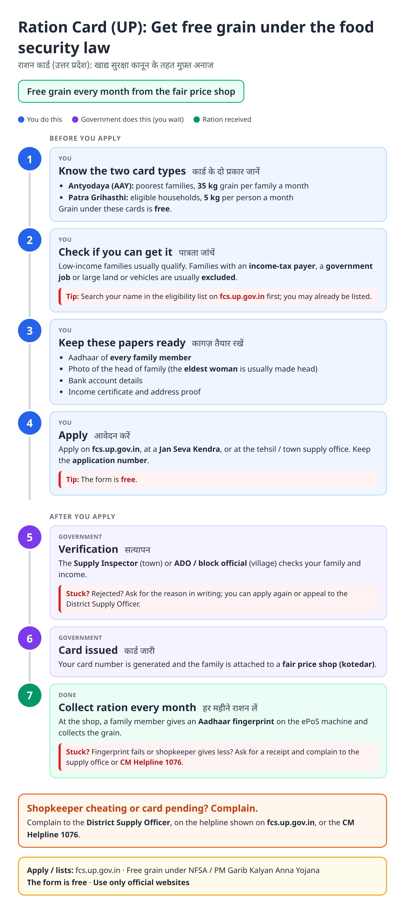
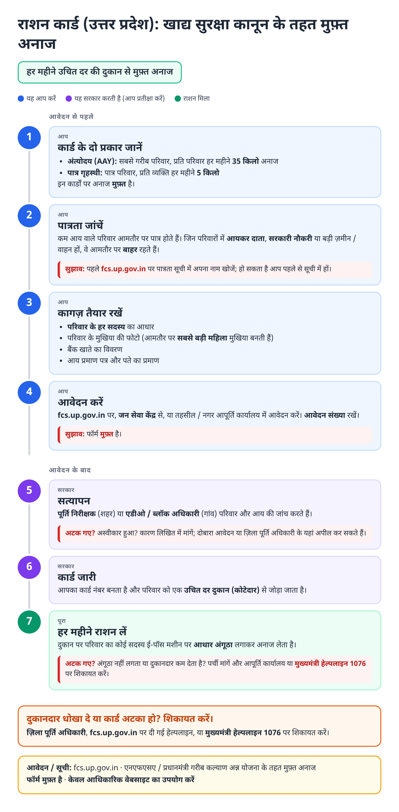
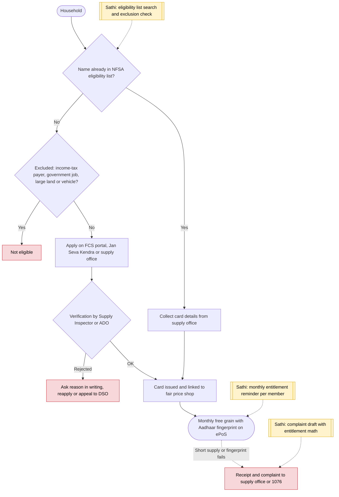

# Ration card (UP, NFSA) - End-to-End Workflow

राशन कार्ड · For: Low-income households

## For citizens: step by step

Blue = you do this. Purple = government does this (you wait). Green = done. Red = what to do if stuck. Orange = your rights if it is late.

### English

### हिंदी (Hindi)

Sources: [`up-ration-card-guide.html`](up-ration-card-guide.html), [`up-ration-card-guide-hi.html`](up-ration-card-guide-hi.html), generated from [`up_ration_card_content.py`](up_ration_card_content.py) with `python3 ../gen_guide.py up_ration_card_content.py`. Hindi text pending native-speaker review.

## Official links

Use only these addresses. Checked on 27 Oct 2026 through search results; the government sites could not be opened directly from our build environment. "Third-party sites only" means several non-government sites agree on the address but no government page confirmed it yet, so open it and check before you share it.

| What | Link | Checked via |
| :--- | :--- | :--- |
| FCS UP (Aapurti): apply, eligibility lists | <https://fcs.up.gov.in> | Third-party sites only |
| Etah district: ration card service page | <https://etah.nic.in/service/ration-card/> | Government page |
| CM Helpline: 1076 | - | Third-party sites only |

## For the Sathi team: system workflow

## Verification (27 Oct 2026)

- **Standard NFSA entitlements:** Antyodaya 35 kg per family, priority households 5 kg per person a month; free under PM Garib Kalyan Anna Yojana.
- **Conflicting:** whether UP accepts fully online applications or only downloaded forms submitted at CSC / tehsil. The guide gives all three routes.
- **Left out:** exact exclusion thresholds (land size, vehicle type), which differ by notice.

Sources: [Etah district: ration card](https://etah.nic.in/service/ration-card/) · [Tribune: UP ration card application process](https://www.tribuneindia.com/news/impact-feature/up-ration-card-application-process-download-status-and-required-documents) · [BankBazaar: UP ration card](https://bankbazaar.com/ration-card/up-ration-card.html)
