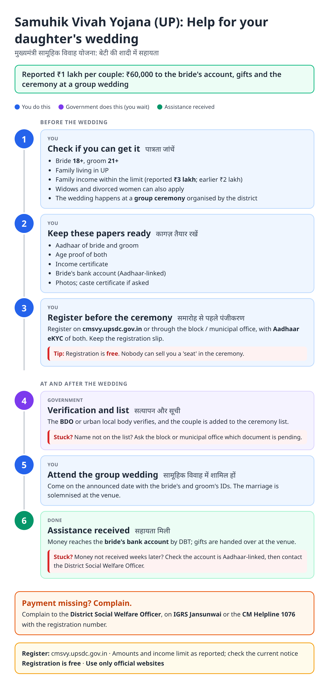
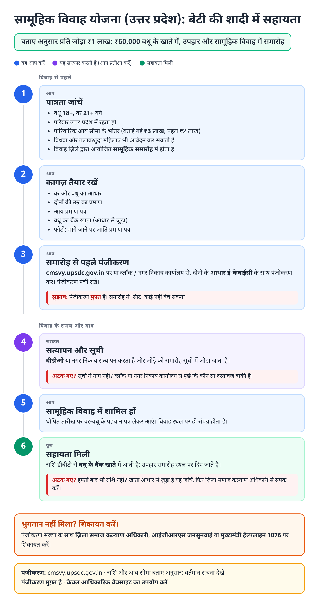
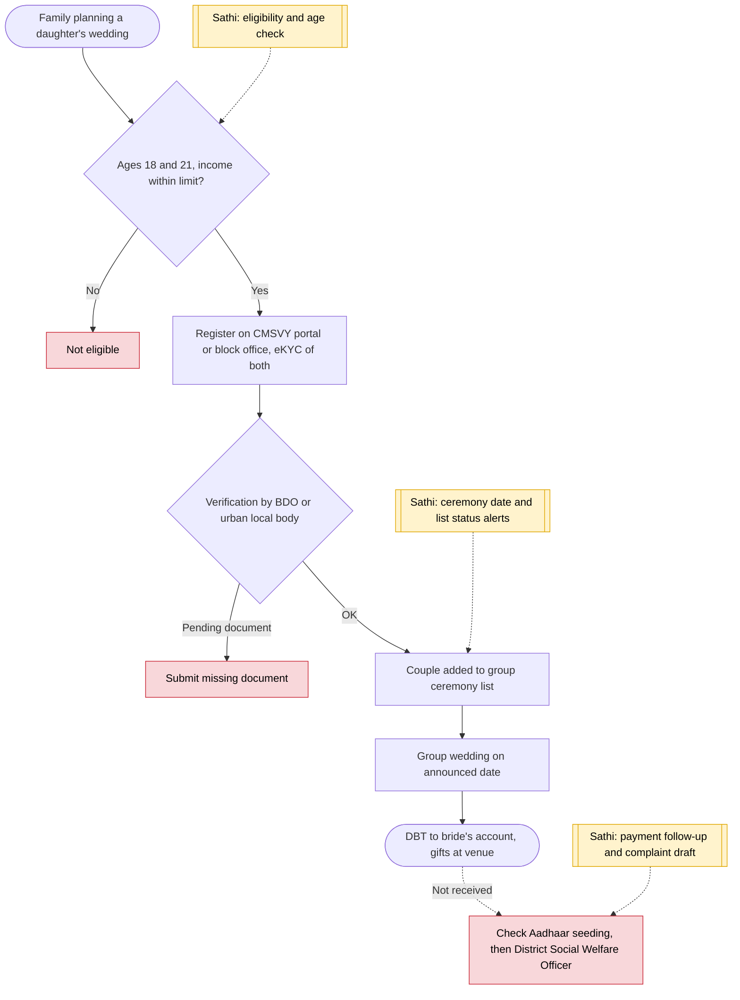

# Mukhyamantri Samuhik Vivah Yojana - End-to-End Workflow

मुख्यमंत्री सामूहिक विवाह योजना · For: Low-income families marrying a daughter

## For citizens: step by step

Blue = you do this. Purple = government does this (you wait). Green = done. Red = what to do if stuck. Orange = your rights if it is late.

### English

### हिंदी (Hindi)

Sources: [`up-samuhik-vivah-guide.html`](up-samuhik-vivah-guide.html), [`up-samuhik-vivah-guide-hi.html`](up-samuhik-vivah-guide-hi.html), generated from [`up_samuhik_vivah_content.py`](up_samuhik_vivah_content.py) with `python3 ../gen_guide.py up_samuhik_vivah_content.py`. Hindi text pending native-speaker review.

## Official links

Use only these addresses. Checked on 27 Oct 2026 through search results; the government sites could not be opened directly from our build environment. "Third-party sites only" means several non-government sites agree on the address but no government page confirmed it yet, so open it and check before you share it.

| What | Link | Checked via |
| :--- | :--- | :--- |
| CMSVY portal: registration | <https://cmsvy.upsdc.gov.in> | Third-party sites only |
| myScheme: Mukhyamantri Samuhik Vivah Yojana | <https://www.myscheme.gov.in/schemes/msvy> | Government page |
| IGRS Jansunwai: complaints | <https://jansunwai.up.nic.in> | Third-party sites only |
| CM Helpline: 1076 | - | Third-party sites only |

## For the Sathi team: system workflow

## Verification (27 Oct 2026)

- **Reported (UNI, state announcement):** assistance raised from ₹51,000 to ₹1 lakh; ₹60,000 to the bride's account, ₹25,000 gifts; income limit raised from ₹2 lakh to ₹3 lakh.
- **Conflicting:** older pages still show ₹51,000 and ₹2 lakh; BPL condition unclear. The guide marks amounts as 'reported'.
- **Still unverified:** current portal address (older pages name shadianudan.upsdc.gov.in).

Sources: [UNI: girls to receive ₹60,000 under CM Samuhik Vivah Yojana](https://uniindia.com/girls-to-receive-rs-60k-under-cm-samuhik-vivah-yojana-yogi/north/news/3447437.html) · [myScheme: MSVY](https://www.myscheme.gov.in/schemes/msvy) · [sarkariyojana.com: Samuhik Vivah Yojana 2026](https://sarkariyojana.com/mukhyamantri-samuhik-vivah-yojana/) · [citizennest: apply online guide](https://www.citizennest.com/scheme/mukhyamantri-samuhik-vivah-yojana-apply-online-uttar-pradesh)
