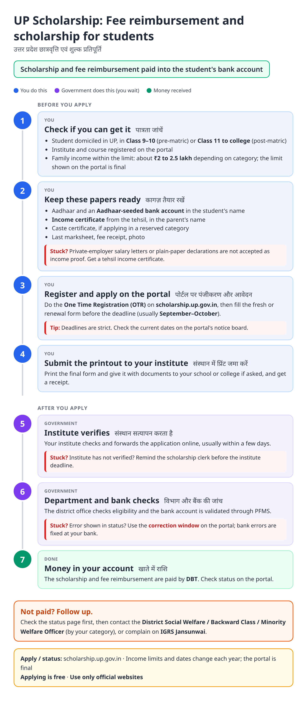
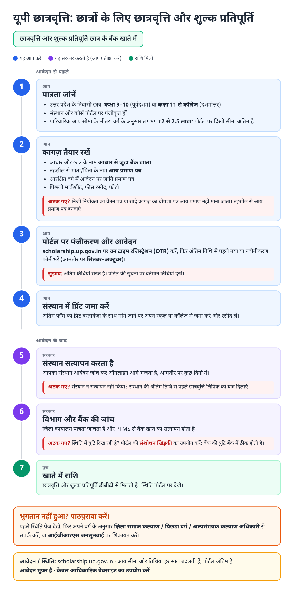
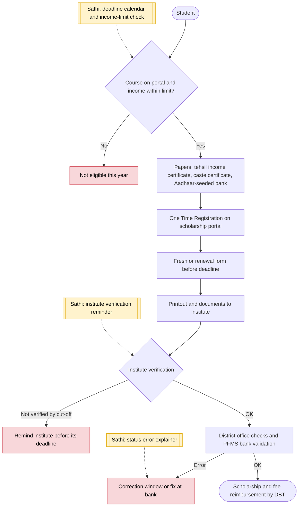

# UP Scholarship (pre and post-matric) - End-to-End Workflow

यूपी छात्रवृत्ति · For: Students from Class 9 to college

## For citizens: step by step

Blue = you do this. Purple = government does this (you wait). Green = done. Red = what to do if stuck. Orange = your rights if it is late.

### English

### हिंदी (Hindi)

Sources: [`up-scholarship-guide.html`](up-scholarship-guide.html), [`up-scholarship-guide-hi.html`](up-scholarship-guide-hi.html), generated from [`up_scholarship_content.py`](up_scholarship_content.py) with `python3 ../gen_guide.py up_scholarship_content.py`. Hindi text pending native-speaker review.

## Official links

Use only these addresses. Checked on 27 Oct 2026 through search results; the government sites could not be opened directly from our build environment. "Third-party sites only" means several non-government sites agree on the address but no government page confirmed it yet, so open it and check before you share it.

| What | Link | Checked via |
| :--- | :--- | :--- |
| UP Scholarship portal: OTR, apply, status | <https://scholarship.up.gov.in> | Third-party sites only |
| IGRS Jansunwai: complaints | <https://jansunwai.up.nic.in> | Third-party sites only |

## For the Sathi team: system workflow

## Verification (27 Oct 2026)

- **Reported for 2026-27:** applications on scholarship.up.gov.in; fresh applications open to 31 October 2026; renewal deadline reported as 15 or 31 October.
- **Conflicting:** income limits by category (sources swap ₹2 lakh and ₹2.5 lakh between groups). The guide says 'about ₹2 to 2.5 lakh; the portal is final'.
- **Single-source, left out:** DigiLocker and 75 percent biometric attendance requirement.

Sources: [Careers360: UP Scholarship 2026-27 deadlines](https://news.careers360.com/up-scholarship-2026-27-renewal-deadline-tomorrow-fresh-applications-till-oct-31-eligibility-explained-classes-9-12-students) · [CareerIndia: UP Scholarship 2026-27](https://www.careerindia.com/news/up-scholarship-2026-27-apply-online-before-october-31-066877.html) · [Buddy4Study: UP Scholarship 2026-27](https://www.buddy4study.com/article/top-scholarships-for-students-of-uttar-pradesh) · [IndiaScholarships: UP post-matric scholarship](https://www.indiascholarships.in/scholarships/up-postmatric-dashmotar-scholarship)
