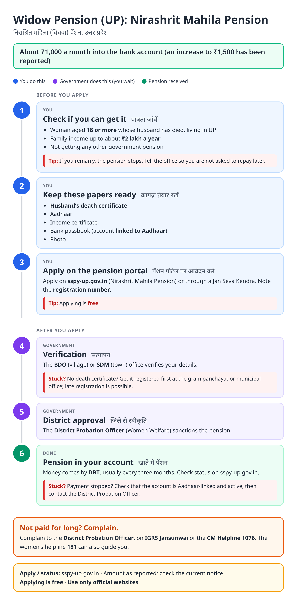
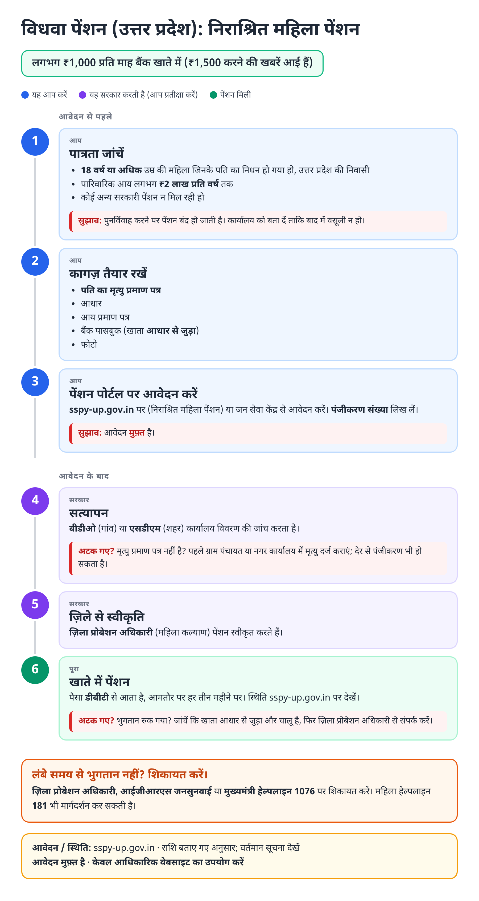
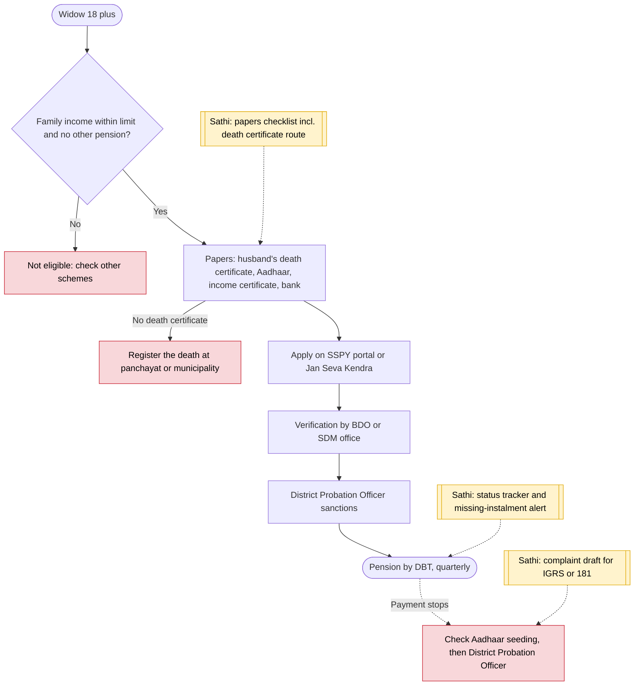

# Nirashrit Mahila Pension (UP widow pension) - End-to-End Workflow

निराश्रित महिला पेंशन · For: Widows 18+ with low family income

## For citizens: step by step

Blue = you do this. Purple = government does this (you wait). Green = done. Red = what to do if stuck. Orange = your rights if it is late.

### English

### हिंदी (Hindi)

Sources: [`up-widow-pension-guide.html`](up-widow-pension-guide.html), [`up-widow-pension-guide-hi.html`](up-widow-pension-guide-hi.html), generated from [`up_widow_pension_content.py`](up_widow_pension_content.py) with `python3 ../gen_guide.py up_widow_pension_content.py`. Hindi text pending native-speaker review.

## Official links

Use only these addresses. Checked on 27 Oct 2026 through search results; the government sites could not be opened directly from our build environment. "Third-party sites only" means several non-government sites agree on the address but no government page confirmed it yet, so open it and check before you share it.

| What | Link | Checked via |
| :--- | :--- | :--- |
| SSPY UP: social pension portal | <https://sspy-up.gov.in> | Third-party sites only |
| IGRS Jansunwai: complaints | <https://jansunwai.up.nic.in> | Third-party sites only |
| CM Helpline: 1076 | - | Third-party sites only |
| Women helpline: 181 | - | Third-party sites only |

## For the Sathi team: system workflow

## Verification (27 Oct 2026)

- **Reported:** ₹1,000 a month by DBT to about 36 lakh women; family income up to ₹2 lakh; husband's death certificate required.
- **Conflicting:** a hike to ₹1,500 is described as announced by one source and as only under consideration by another. The guide says ₹1,000 with the increase 'reported'.
- **Still unverified:** sanctioning officer title on the current portal.

Sources: [The Week: ₹1,115 crore pension to 36 lakh destitute women](https://www.theweek.in/wire-updates/national/2025/08/06/des54-up-pension-destitute-women.html) · [sarkariyojana.com: UP widow pension](https://sarkariyojana.com/up-widow-pension-scheme/) · [Navbharat Live: UP widow pension](https://navbharatlive.com/utility-news/up-widow-pension-scheme-1000-monthly-benefits-eligibility-how-to-apply-yogi-government-1692223.html) · [schemesinindia: UP Nirashrit Mahila Pension](https://schemesinindia.in/schemes/uttar-pradesh/up-nirashrit-mahila-pension)
